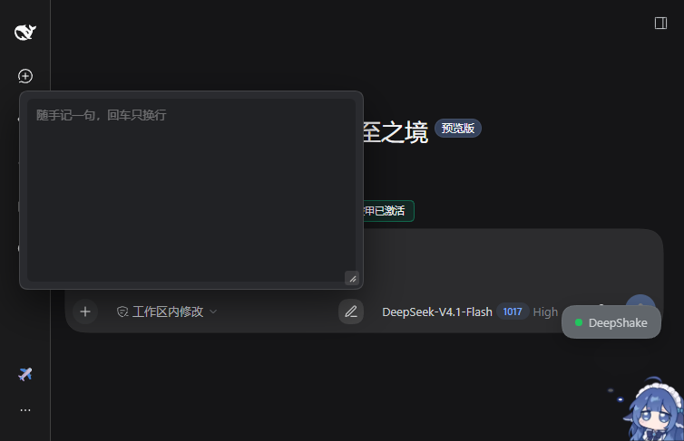
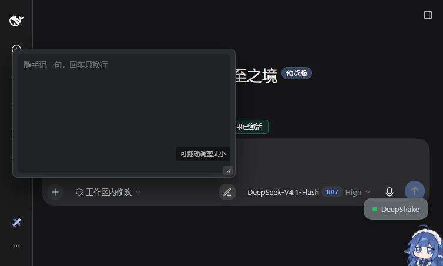

# dsh-composer-scratchpad

[English](README.en.md) | 中文


**输入框边上的一个草稿格。** 点工具栏那支铅笔，弹出一个纯净文本框：先把灵感写进去，
回车只换行，**永远不会发出去**。想好了再自己挪进输入框。



## 它解决什么

你想写东西，但还没想好要不要发给模型。直接敲进输入框，一行回车就把半成品发出去了；
写进别的笔记应用，再切回来复制，上下文已经凉了。

这个插件在 **composer 工具栏**里加一个入口，内容仅存本机 `localStorage`，**所有会话共用同一份**，
切会话、切项目、刷新、重启都不丢。

## 和笔记插件的区别

生态里已经有很完整的笔记插件（比如 `dsh-client-ui-notes`：文件树、标签页、Markdown 预览）。
那个解决的是「管理一堆文件」。

这个只解决一件事：**你还没决定发不发的那一句话**。所以它故意没有文件夹、没有标签、没有多页，
也故意没有发送按钮。

## 截图

| 打开面板 | 一次性尺寸提示 |
| --- | --- |
|  |  |

## 运行环境

| 项 | 要求 |
| --- | --- |
| 宿主 | DSH Web 端（`dsh web`）或桌面端；桌面端跑的仍是 `profiles/web` 这一套 |
| DSH 版本 | `>= 0.2.0`（见 `engines.dsh`）。`0.2.1-rc.2` 实测正常，更早版本未验证 |
| 挂载点 | 客户端插槽 `conversation.input.right`，由 `@deepseek-ai/dsh-client-ui-conversation` 提供 |
| 浏览器 | 任何支持 `localStorage` 的浏览器；桌面端内嵌 WebView 同样可用 |
| Node | `>= 18`，只用于 `npm test`；插件本身运行不需要 Node |
| 网络 | 不需要。零依赖、无构建步骤、不发起任何请求 |

装上后工具栏没有铅笔图标，就按这个顺序排查：

1. 重启内核——客户端模块清单在启动期生成，热装不会自动进清单；
2. `Ctrl+Shift+R` 硬刷新——客户端 bundle 带 `cache-control: immutable`，普通刷新拉不到新的；
3. `dsh plugin list --profile web` 确认插件真的进了 `bundles`；
4. 都没有就核对宿主版本，`conversation.input.right` 在这个版本里是否还存在。

面板配色只按深色主题写过（见下方「已知边界」），浅色主题下会难看——那是外观问题，不是装错了。

## 安装

### 桌面端 / 网页端（图形界面）

在侧栏 **插件** 面板里添加 GitHub 源：

```
github:br0caz/dsh-composer-scratchpad
```

### 命令行

```sh
dsh plugin --profile web add github:br0caz/dsh-composer-scratchpad
```

### 走 npm（发布之后）

包还没发到 npm，上面两条走的是 GitHub 源。等 `dsh-composer-scratchpad` 上架 npm 之后，
才可以只写包名：

```sh
dsh plugin --profile web add dsh-composer-scratchpad
```

装完重启内核（客户端模块清单在启动期生成）。**从源码或本地路径装时**，改完 `client.js`
还要 `Ctrl+Shift+R` 硬刷新一次——客户端 bundle 带 `cache-control: immutable`，
普通刷新不会重新拉。

## 用法

| 操作 | 结果 |
| --- | --- |
| 点铅笔图标 | 打开 / 收起面板 |
| `Esc` 或点面板外 | 收起 |
| `Enter` | **只换行**（键盘事件在面板内就地截断，不进主编辑器的提交链路） |
| 拖动右下角把手 | 左拖变宽、上拖变高（面板贴着工具栏往上弹） |
| 双击把手 | 回到默认 380×220 |
| 图标右上角小点 | 表示里面还有内容 |

第一次打开时会浮出一句「可拖动调整大小」，2.4 秒淡出。判据是**教到会为止**：
拖过一次就永不再提；没拖过最多提 3 次。

## 数据在哪

| 键 | 内容 |
| --- | --- |
| `dsh-composer-scratchpad` 前缀（历史键名 `dsh-memo-pad:*`） | 正文、面板尺寸、提示计数 |

只写本机 `localStorage`，不联网、不进会话、不上传。换浏览器或清站点数据会丢；
需要跨设备请用浏览器账号同步或自行导出。

## 实现

没有构建步骤，没有依赖：

- `client.js` —— 全部逻辑与 UI，手写 `window.__ModuleLoader__.load({ id, factory })`，
  React 从宿主模块表 `require` 得到，不打包、不带 React 副本；
- 挂载点是客户端插槽 `conversation.input.right`（composer 工具栏、模型选择器左边）。
  不占用 `conversation.input.activity`——那个是单例槽，通常被语音输入插件占了；
- `index.js` —— 宿主半边，故意为空；
- `cordis.patch.yml` —— 让插件管理器一键挂载；
- `tests/smoke.cjs` —— 迷你 React + 迷你 DOM 的 7 项自测，`npm test` 即可跑，不需要浏览器。

## 已知边界

- 面板配色按深色主题写死（`#2a2b2f`）；
- 只有一个文本框、单份内容（这是设计，不是没做完）；
- 内容不进工作区文件，AI 读不到（同样是有意的：这是你的草稿，不是给模型的上下文）。

## License

MIT
